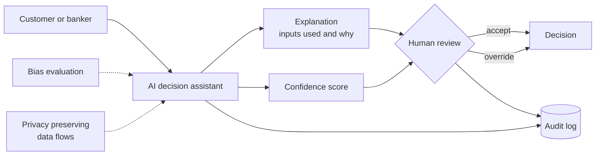

# Trusted AI in Banking: PNC CSL Case Competition

For the PNC CSL Case Competition, I designed an explainable AI assistant for financial decisions. The question behind it: how can a bank use AI to help customers and staff while being able to explain, check, and audit every recommendation?

This repo summarizes the design.

## The design

### Explainable by default

Every recommendation shows which model inputs drove it, so a banker or customer can see why the assistant suggested what it did.

### Confidence and human override

Each answer carries a confidence score, and a person can always override the assistant. The assistant supports a decision but never makes it alone.

### Bias evaluation

The design includes bias evaluation to check that recommendations do not treat customer groups unequally.

### Audit logging

Every recommendation, explanation, and human override is written to an audit log that can't be changed afterward. That log is what lets a bank answer a regulator's question months later.

### Privacy and regulation

Data flows are designed to share only what each step needs. The governance framework was aligned with SR 11-7 model risk guidance and OCC expectations for banks using models.

## What I took from it

Most of the value of a trusted AI system is outside the model: what it shows, who can overrule it, and what it records. Those parts decide whether a bank can actually use it.

## Contact

Sumit Kashid · [sumit-kashid.github.io](https://sumit-kashid.github.io) · [LinkedIn](https://www.linkedin.com/in/sumit-kashid/) · sumitkashid505@gmail.com
